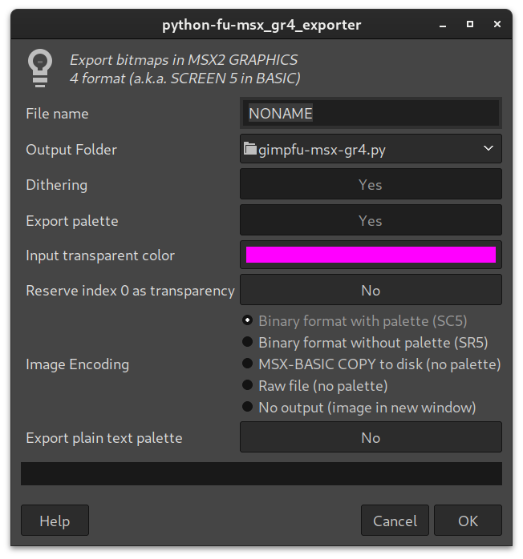
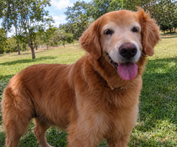
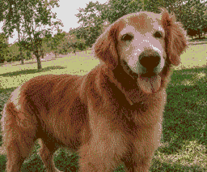

# gimp-msx-g4.py



GIMP script to export bitmap as GRAPHICS 4 file (a.k.a. "SCREEN 5"). GRAPHICS 4 specs are: 

* 4 pages;
* 256x1024 image (256 per page) with a 256x212 or 256x192 viewport;
* 16 color palette (from 512);
* sprite mode 2;

The plug-in also exports **SCREEN 7** images (GRAPHIC 6, 512x212, 16 colors) and supports **interlaced** images (double vertical resolution, 424 lines).

Plug-in is accessible through _Filters > MSX >> MSX2 Graphics 4 Image Converter_.  You may disable **Image Encoding** altogether to create an image inside GIMP and not export it to disk at all. In this case, the plug-in doesn't check image size. But be warned: big images tend to take a very. Long. Time.

### Meaning of input fields

* Input transparent color: if the source image doesn't have any transparency, consider this colour the transparent colour when converting image to the MSX (set index to 0). This requires "Reserve index 0 as transparency" to be active.
* Reserve index 0 as transparency: the plugin can optionally use the colour index 0 as a normal colour and get one more usable colour. It may improve dithering a little bit if disabled.
* Screen mode: SCREEN5 (256x212, 16 colors, 32K page) or SCREEN7 (512x212, 16 colors, 64K page). The screen mode defines the image width, the page size and the palette address.
* Interlaced: when enabled, the image is split in two pages (even lines in page 0, odd lines in page 1), doubling the vertical resolution (up to 424 lines). See [Interlaced files](#interlaced-files).
* Image encoding: common MSX image formats the plugin recognises.

### Output files

| Image encoding | SCREEN5 | SCREEN7 | Content |
| --- | --- | --- | --- |
| Binary format with palette (SCn) | `NONAME.SC5` | `NONAME.SC7` | MSX binary (BSAVE compatible) with the bitmap and the palette |
| Binary format without palette (SRn) | `NONAME.SR5` | `NONAME.SR7` | MSX binary (BSAVE compatible) with the bitmap only |
| MSX-BASIC COPY to disk (no palette) | `NONAME.DAT` | `NONAME.DAT` | screen dump for the MSX-BASIC `COPY` command |
| Raw file (no palette) | `NONAME.RAW` | `NONAME.RAW` | raw bitmap data, no header |
| No output (image in new window) | - | - | the quantized image is displayed in a new GIMP window |

**Interlaced SCREEN 7 (SCn/SRn)** is split into two files because two 64K pages do not fit in a single BSAVE file: page 0 (even lines) is written as `NONAME.S70` / `NONAME.R70` and page 1 (odd lines) as `NONAME.S71` / `NONAME.R71`. Interlaced SCREEN 5 and interlaced RAW/DAT remain single files.

Two extra files may be written: `NONAME.PAL` (the palette in MSX binary format, when **Export palette** is active) and `NONAME.TXT` (the palette as plain text, when **Export plain text palette** is active).

### Latest changes

* GIMP2 plug-in version got a speed boost;
* The plugin now detects if a predefined transparent colour is being used (alpha=0) and force it to index 0. "Reserve index 0 as transparency" must be activated.
* New GIMP3 plugin version added.
* SCREEN 7 (512x212) support, with its own file formats (SC7/SR7);
* Interlaced images (double vertical resolution) support.

## Original vs sample image

#### As usual, here is a picture of a good girl for comparison:



## Installation: 
- Change permission to execute the file:
  - For GIMP2, ```chmod +x gimp2_msx_g4.py```
  - For GIMP3, ```chmod +x gimp3_msx_g4.py```
- For GIMP 2, put `gimp2_msx_g4.py` in your GIMP plugin directory:
  - if you installed as a normal package, it's `~/.config/GIMP/2.10/plug-ins/`;
  - if you installed as a flatpak package, it's `~/.var/app/org.gimp.GIMP/config/GIMP/2.10/plug-ins/`;
- For GIMP 3, put `gimp3_msx_g4.py` in a subdirectory WITH THE SAME NAME (seriously, it will not detect the plugin otherwise) in the plugin directory:
  - if you installed as a normal package, it's `~/.config/GIMP/2.10/plug-ins/gimp3_msx_g4/`;
  - if you installed as a flatpak package, it's `~/.var/app/org.gimp.GIMP/config/GIMP/2.10/plug-ins/gimp3_msx_g4/`;
- Restart GIMP

## Loading SC5 files

You may load files created by this plug-in using this simple code in BASIC:
```
10 SCREEN 5
20 REM use line below if transparency is disabled
30 VDP(9)=VDP(9) OR &H20
40 BLOAD"NONAME.SC5",S
50 COLOR=RESTORE
60 IF INKEY$ = "" GOTO 60
```
File (NONAME.SC5) contains the pattern and palette data. If image height is 237 pixels or more, the palette data will overwrite the pattern data. It's recommended to use SR5 with a separate palette file in this case.

## Loading SR5 files

Loading SR5 files is just a little different in BASIC:
```
10 SCREEN 5
20 REM use line below if transparency is disabled
30 VDP(9)=VDP(9) OR &H20
40 BLOAD"NONAME.PAL",S
50 COLOR=RESTORE
60 BLOAD"NONAME.SR5",S
70 IF INKEY$ = "" GOTO 70
```
The first file (NONAME.PAL) is the palette and the second file (NONAME.SR5) is the pattern data and you need both to get the right image.

## Loading DAT files

DAT (DATA) files are copies of portions of the screen dumped to a disk file. They are created by MSX-BASIC COPY command and are limited to a maximum of 212 pixels height. Loading DAT files in BASIC is easy:
```
10 SCREEN 5
20 REM use line below if transparency is disabled
30 VDP(9)=VDP(9) OR &H20
40 BLOAD"NONAME.PAL",S
50 COLOR=RESTORE
60 COPY "NONAME.DAT" TO (0,0), 0
70 IF INKEY$ = "" GOTO 70
```
A palette file (NONAME.PAL) is still recommended to restore the image properly.

## Loading SC7 files

SCREEN 7 files are loaded much like SCREEN 5 ones, but the screen mode and the image width are different:

```
10 SCREEN 7
20 REM use line below if transparency is disabled
30 VDP(9)=VDP(9) OR &H20
40 BLOAD"NONAME.SC7",S
50 COLOR=RESTORE
60 IF INKEY$ = "" GOTO 60
```

The palette of a SCREEN 7 file lives at `&HFA80` (instead of `&H7680` for SCREEN 5), so `COLOR=RESTORE` restores it properly.

## Interlaced files

The MSX2 VDP can display up to 424 lines by alternating the even and the odd lines of the image at 60Hz (interlaced mode). The plug-in writes the even lines of the image in page 0 and the odd lines in page 1, so the source image must have twice the vertical resolution of the target screen (e.g. 256x424 for a 256x212 SCREEN 5 screen).

* **SCREEN 5 (SC5/SR5)** keeps the two pages in a single file (32K each, 64K total) so it can be loaded in one `BLOAD`.
* **SCREEN 7 (SCn/SRn)** is split into two files because two 64K pages do not fit in one BSAVE: `NONAME.S70`/`NONAME.R70` (page 0, even lines) and `NONAME.S71`/`NONAME.R71` (page 1, odd lines).
* The **RAW** and **DAT** formats pack both pages together (the second page immediately after the first one).

### Loading interlaced SCREEN 5

```
10 SCREEN 5
20 BLOAD"NONAME.SC5",S
30 COLOR=RESTORE
40 REM enable interlace (IL) and even/odd alternate display (EO)
50 VDP(9)=VDP(9) OR &H0C
60 IF INKEY$="" GOTO 60
```

For `SR5` (no embedded palette), load the palette first: `BLOAD"NONAME.PAL",S: COLOR=RESTORE` and then `BLOAD"NONAME.SR5",S`.

### Loading interlaced SCREEN 7

Interlaced SCREEN 7 needs 128K of VRAM (two 64K pages). Load page 0 to the even page and page 1 to the odd page, then enable interlace (sample programs: `samples/LOAD-SC7I.BAS`, `samples/LOAD-SR7I.BAS`):

```
10 SCREEN 7
20 BLOAD"NONAME.S70",S          ' page 0 (even lines) + palette
30 COLOR=RESTORE
40 SET PAGE 1,1
50 BLOAD"NONAME.S71",S          ' page 1 (odd lines)
60 SET PAGE 0,0
70 REM enable interlace (IL) and even/odd alternate display (EO)
80 VDP(9)=VDP(9) OR &H0C
90 IF INKEY$="" GOTO 90
```

Without embedded palette (`R70`/`R71`), load the palette separately before the pages:

```
10 SCREEN 7
20 BLOAD"NONAME.PAL",S
30 COLOR=RESTORE
40 BLOAD"NONAME.R70",S          ' page 0 (even lines)
50 SET PAGE 1,1
60 BLOAD"NONAME.R71",S          ' page 1 (odd lines)
70 SET PAGE 0,0
80 VDP(9)=VDP(9) OR &H0C
90 IF INKEY$="" GOTO 90
```

## TODO

* [ ] divide big files into 8 or 16K chunks for ROM/mapper if requested;
  * [ ] compress chunks individually;
* [ ] allow different palette conversion functions;
* [ ] ordered dithering (and other dithering patterns);
* [x] make it faster;
* [x] enable or disable transparent colour;
* [x] palette export;
* [x] RGB to indexed conversion;
* [x] export raw file to be used by external compressors;
* [x] ignore alpha channel instead of triggering errors;
* [x] embedded palette support;
* [x] MSX-BASIC COPY to disk format support;
* [x] enable user to define the transparent colour;
* [x] SCREEN 7 mode;
* [x] interlaced mode (double vertical resolution);
* [ ] RLE encoding;
* [ ] aPLib compression;
* [ ] converting layers into pages;
